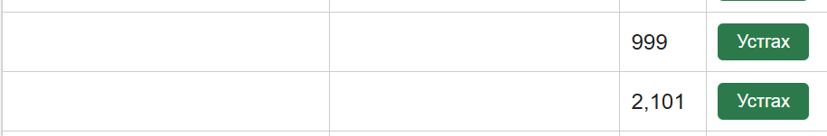
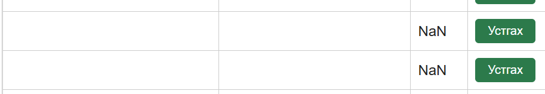

# BUG-01: Оны шалгалт байхгүй: 999, 2101, "abc" зэрэг утга хадгалагдаж, он хоосон бол 0 болдог

Орчин:  Уншлагын жагсаалт v2.0, Firefox 131.0, Ubuntu (WSL2) дээрх node v25.9.0, 2026-10-21
Урьдчилсан нөхцөл: node app.js-ийг шинээр асаасан (анхны 3 ном)

## Дахин гаргах алхам
1. http://localhost:3000 нээнэ.
2. Гарчиг: `Тест`, Зохиолч: `Тест`, Он: `2101` оруулаад "Нэмэх" дарна.
3. Дахин адил хийж Он дээр `999`, дараа нь `abc` оруулна (гарчгийг өөрчилж болно).
4. Он хоосон үлдээгээд "Нэмэх" дарна.

Хүлээгдэж байсан: «Он нь 1000-2100 хоорондох бүхэл тоо» (спецификаци). Муж, төрөл зөрвөл ном нэмэгдэхгүй, ойлгомжтой алдааны мессеж гарна.
Бодит үр дүн:     Бүх тохиолдолд ном нэмэгддэг. `abc` дээр хүснэгтэд `NaN` харагдсан, он хоосон үед `0` болсон. `GET /api/books`-д year нь "999", "2101", "abc" гэж хадгалагдсан байсан.

Ноцтой байдал: Major. Спецификацийн гол баталгаажуулалтын дүрэм огт ажиллахгүй, өгөгдөл буруу хадгалагдана.
Хавсралт:      screenshots/bug-01.png · screenshots/bug-01-abc.png

Олдсон аялал:  Couch Potato
