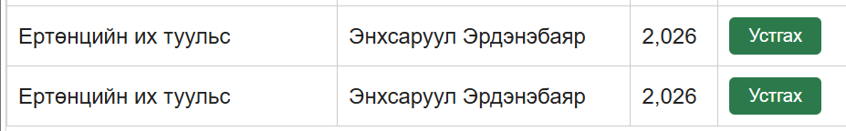

# BUG-03: Ижил гарчиг, зохиолч, оноор ном давхардан нэмэгддэг

Орчин:  Уншлагын жагсаалт v2.0, Firefox 131.0, Ubuntu (WSL2) дээрх node v25.9.0, 2026-10-21
Урьдчилсан нөхцөл: node app.js-ийг шинээр асаасан (анхны 3 ном)

## Дахин гаргах алхам
1. http://localhost:3000 нээнэ.
2. Гарчиг: `Ертөнцийн их туульс`, Зохиолч: `Энхсаруул Эрдэнэбаяр`, Он: `2026` оруулаад "Нэмэх" дарна.
3. Яг ижил утгыг дахин оруулаад "Нэмэх" дарна.

Хүлээгдэж байсан: «Ижил гарчиг, зохиолчтой ном давхардуулж нэмэгдэхгүй» (спецификаци).
Бодит үр дүн:     Хоёр дахь удаад ч ном нэмэгдэж, хүснэгтэд хоёр ижил мөр харагдсан. `GET /api/books`-д id 11, 12 адил агуулгатай байсан.

Ноцтой байдал: Major. Өгөгдөл давхардаж, жагсаалт болон тоолуур буруу болно.
Хавсралт:      screenshots/bug-03.png

Олдсон аялал:  Couch Potato (давхардсан оролт)
