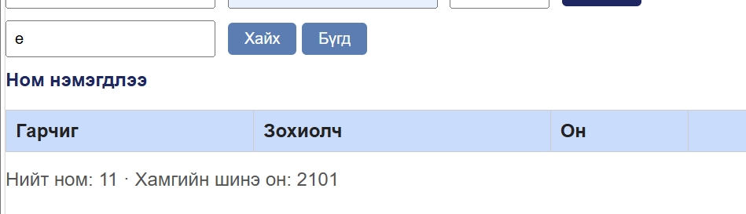
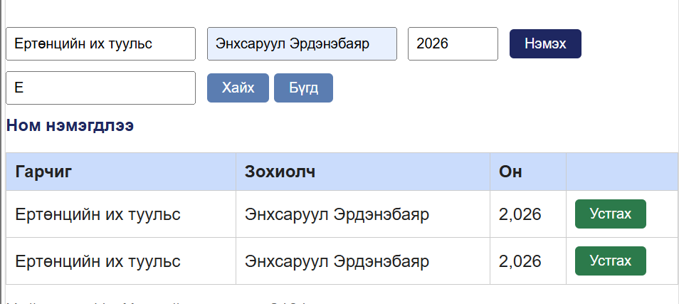

# BUG-04: Хайлт том/жижиг үсгийг ялгадаг

Орчин:  Уншлагын жагсаалт v2.0, Firefox 131.0, Ubuntu (WSL2) дээрх node v25.9.0, 2026-10-21
Урьдчилсан нөхцөл: node app.js-ийг шинээр асаасан (анхны 3 ном)

## Дахин гаргах алхам
1. http://localhost:3000 нээнэ.
2. Хайлтад `Clean` бичиж үр дүнг тэмдэглэнэ.
3. Хайлтыг `clean` болгож үр дүнг тэмдэглэнэ.

Хүлээгдэж байсан: «Хайлт гарчиг болон зохиолчоос хайх ба том/жижиг үсэг ЯЛГАХГҮЙ» (спецификаци): хоёр хайлт ижил үр дүн өгнө.
Бодит үр дүн:     Session-ийн үеэр том үсгээр бичихэд 2 үр дүн, жижиг үсгээр бичихэд 0 үр дүн гарсан.

Ноцтой байдал: Major. Хэрэглэгч байгаа номыг олж чадахгүй.
Хавсралт:      screenshots/bug-04.png · screenshots/bug-04-b.png

Олдсон аялал:  Couch Potato (хайлтын хилийн оролт)
