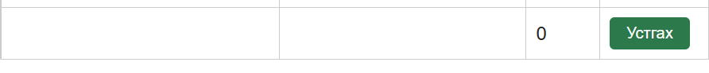

# BUG-06: Гарчиг, Зохиолч, Он бүгд хоосон байхад ном нэмэгддэг

Орчин:  Уншлагын жагсаалт v2.0, Firefox 131.0, Ubuntu (WSL2) дээрх node v25.9.0, 2026-10-21
Урьдчилсан нөхцөл: node app.js-ийг шинээр асаасан (анхны 3 ном)

## Дахин гаргах алхам
1. http://localhost:3000 нээнэ.
2. Гурван талбарыг бүгдийг хоосон орхиод "Нэмэх" дарна.

Хүлээгдэж байсан: «Гурван талбар бүгд заавал бөглөгдсөн байх ёстой; дутуу бол ном нэмэгдэхгүй, ойлгомжтой алдааны мессеж харагдана» (спецификаци).
Бодит үр дүн:     Ном нэмэгдэж, "Ном нэмэгдлээ" мессеж гарсан. `GET /api/books`-д `"title":"","author":""` мөр хадгалагдсан байсан.

Ноцтой байдал: Major. Заавал бөглөх дүрэм зөрчигдөж, хоосон мөр жагсаалтад нэмэгдэнэ.
Хавсралт:      screenshots/bug-06.png (доорх алхамаар авна)

Олдсон аялал:  Couch Potato
